# CFHarvest replica — data model (`cfharvest` schema)

Postgres 15 schema for the replica's real data layer (PLAN_OVERNIGHT.md §2). Files:

| File | Purpose |
|---|---|
| `schema.sql` | Idempotent DDL: schema `cfharvest`, 13 enums, 34 tables, 2 views, status-audit and `updated_at` triggers. Re-runnable; never drops data; columns added later use `ADD COLUMN IF NOT EXISTS`, so older databases are upgraded in place. |
| `seed.sql` | Demo tenant "Demo-Lohnunternehmen": client TRI, H-01 / F-01 / K-01, the game's three stands as work orders H-A01 / H-B01 / H-C01, the Standardauftrag order book, Administration master data (roles, users with resource access, map layers, message templates). Idempotent (deterministic ids + `ON CONFLICT DO NOTHING`; one-time `UPDATE`s fill columns added after a database was first seeded). |
| `grants.sql` | PostgREST grants for the demo (`anon`, `authenticated`): usage on the schema, select/insert/update on every table, delete on the tables the store mirrors. Demo only, RLS is off (see `README.md`). |
| `apply.sh` | `apply.sh <DATABASE_URL> [--grants]`: runs `schema.sql` then `seed.sql` (and `grants.sql`) with `psql`, then prints the two one-time Supabase dashboard steps. |
| `README.md` | Setting up Supabase (new project or isolated schema in an existing one), filling `app/config.js`, switching the replica's store, security caveat. |
| `SCHEMA.md` | This document. The column tables in §3 were generated from the database catalogue and the comments in `schema.sql`; the §2 store-pass additions (marked †) were added by hand in the same format. |

Source keys as in `SPEC_PLANNING.md` / `evidence/CAPTURE_LOG.md` (**[Mnn]** manual screenshot, **[V6-m:ss]** video frame, **[MW]** manual text, **[SS]** spec sheet, **[VS]** Viktiga steg, **[MM]** Manual Maskin). **[DEMO]** = our design decision, nothing observed. **approx.** = StanForD 2010 element names recalled from the standard, not checked against the Skogforsk XSDs. **[DEMO game]** = a value or column that exists only because the INTERFORST game needs it.

Apply: `cfharvest/db/apply.sh "$DATABASE_URL" --grants` (or `psql "$DATABASE_URL" -f cfharvest/db/schema.sql -f cfharvest/db/seed.sql -f cfharvest/db/grants.sql`, or paste the three files into the Supabase SQL editor, in that order). Validation: §9.

## 1. Design rules

- **Tenant everywhere.** Every table has `tenant_id uuid NOT NULL` → `company(id)` (`company.tenant_id` is generated as its own id). RLS is off for the demo; the header of `schema.sql` has the policy template, and its last `DO` block fails if a table without `tenant_id` is ever added. Deleting the `company` row removes the whole tenant: child-to-child foreign keys use `NO ACTION` (checked at end of statement), not `RESTRICT`, so the cascade can finish.
- **Surrogate keys, app ids as business keys.** All primary keys are `uuid`; the ids the app shows (H-A01, H-01, F-01, K-01, P-A01, V-26-014, B-V-26-014) are `order_no` / `code` / `contract_no` / `book_no`, unique per tenant. The seed uses `md5('cfh-demo:<kind>:<key>')::uuid`, so any script can address demo rows without a lookup (e.g. `md5('cfh-demo:wo:H-A01')::uuid`).
- **Planned, reported and delivered volumes stay separate.** Plans live in `work_order.planned_volume_m3`, `assortment.planned_m3` and `assignment`. Reported production lives in `production_message` / `production_line` (HPR → felled, FPR → forwarded). Trucks live in `delivery`. The views derive *forest stock = felled − forwarded* and *roadside = forwarded − delivered*. Nothing stores a running stock that could drift.
- **Prices are not stored on assortments.** They live on `contract.prices` (by sortiment code) and `order_line.price_eur_per_m3`.
- **Product vocabulary.** Enum values and comments keep the Swedish product terms (`drivningskedja`, `skogsagare`, `Slutavverkning`). The German labels stay in the app (`i18n-cfharvest.js`), and `cfharvest.status_title(status, 'sv'|'de')` returns the long status text.
- **Geometry is GeoJSON in `jsonb`.** In the demo the coordinates are the game's image coordinates (`bridge.js world()`), not WGS84 and not cadastral boundaries (SPEC §7a). The `geometry` column is ready for a later PostGIS `geometry(MultiPolygon,4326)` generated column.
- **Staging stays in the client.** The calendar's unsaved changes (`staged`, `touched`, the Återställ counter) are never written. Only Spara writes `assignment` rows.

## 2. Entity-relationship diagram

Every table also references `company` through `tenant_id`; those edges are left out below, except for the top-level entities. Attributes shown are keys and the columns that carry each relationship. §3 lists every column.

```mermaid
erDiagram
  company ||--o{ app_user : "employs"
  company ||--o{ role : "defines"
  company ||--o{ client : "serves"
  company ||--o{ resource : "owns"
  company ||--o{ team : "forms"
  company ||--o{ receiving_place : "delivers to"
  company ||--o{ operation_type : "offers"
  app_user ||--o{ app_user_role : "has"
  role ||--o{ app_user_role : "granted"
  resource |o--o{ app_user : "Mobil/Maskin login"
  app_user ||--o{ app_user_resource : "Tillgång till resurser"
  resource ||--o{ app_user_resource : "visible to"
  resource ||--o{ resource_transfer : "Resursöverföringar"
  company ||--o{ map_layer_config : "Kartskikt"
  company ||--o{ message_template : "Meddelande mallar"
  client ||--o{ contract : "Avtal"
  contract ||--o{ contract_operation_type : "covers"
  operation_type ||--o{ contract_operation_type : "in"
  resource ||--o{ resource_production_rate : "Produktionsdata"
  operation_type ||--o{ resource_production_rate : "per åtgärd"
  resource ||--o{ resource_weekly_hours : "Veckoarbetstid"
  resource ||--o{ calendar_override : "Veckokalender"
  team ||--|{ team_member : "members"
  resource ||--o{ team_member : "belongs to"
  client ||--o{ work_order : "Uppdragsgivare"
  contract |o--o{ work_order : "Kontrakt nr."
  operation_type |o--o{ work_order : "Åtgärd"
  work_order |o--o{ work_order : "Föreg. arbetsorder"
  work_order ||--o{ work_order_status_history : "Statusändringar"
  work_order ||--o{ assortment : "Sortiment"
  receiving_place ||--o{ assortment : "Mottagningsplats"
  work_order ||--o{ landing : "Avlägg"
  work_order ||--o{ map_symbol : "Hänsyn"
  work_order ||--o{ contact : "Kontaktuppgifter"
  work_order ||--o{ assignment : "planned as"
  resource |o--o{ assignment : "single machine"
  team |o--o{ assignment : "chain / group"
  assignment |o--o{ assignment : "Kopiera"
  work_order ||--o{ instruction_file : "OIN PIN FOI FDI"
  assignment |o--o{ instruction_file : "sent with"
  assortment |o--o{ instruction_file : "PIN"
  work_order |o--o{ production_message : "HPR FPR HQC"
  resource |o--o{ production_message : "reported by"
  production_message ||--o{ production_line : "volumes"
  assortment ||--o{ production_line : "per product"
  work_order ||--o{ delivery : "Abfuhr"
  assortment ||--o{ delivery : "of"
  landing |o--o{ delivery : "from"
  client ||--o{ order_book : "Beställning"
  contract |o--o{ order_book : "for"
  order_book ||--o{ order_line : "rows"
  receiving_place ||--o{ order_line : "Mottagningsplats"
  message ||--o{ message_recipient : "to"
  work_order |o--o{ message : "about"

  company {
    uuid id PK
    uuid tenant_id "generated = id"
    text name
  }
  resource {
    uuid id PK
    text code UK "H-01"
    resource_type type
    text stanford_code UK "90001"
  }
  team {
    uuid id PK
    text code UK "K-01"
    team_kind kind
    numeric forwarder_lag_days
  }
  client {
    uuid id PK
    text code UK "TRI"
    text_array regions
  }
  contract {
    uuid id PK
    text contract_no UK "V-26-014"
    jsonb prices
  }
  work_order {
    uuid id PK
    text order_no UK "H-A01"
    work_order_status status
    numeric planned_volume_m3
    uuid client_id FK
    uuid contract_id FK
    uuid operation_type_id FK
    uuid predecessor_id FK
    jsonb geometry
  }
  assortment {
    uuid id PK
    uuid work_order_id FK
    uuid receiving_place_id FK
    text sortiment_code "SAG IND ABW"
    numeric planned_m3
    text pin_file_name
  }
  assignment {
    uuid id PK
    uuid work_order_id FK
    uuid resource_id FK "xor team_id"
    uuid team_id FK
    timestamptz start_at
    timestamptz end_at
    numeric manual_hours
    assignment_status status
  }
  production_message {
    uuid id PK
    production_kind kind "HPR FPR HQC FQC MOM"
    uuid resource_id FK
    uuid work_order_id FK
    jsonb payload
  }
  production_line {
    uuid id PK
    uuid message_id FK
    uuid assortment_id FK
    numeric felled_m3
    numeric forwarded_m3
  }
  order_book {
    uuid id PK
    text book_no UK
    order_book_status status
    followup_basis followup_basis
  }
  order_line {
    uuid id PK
    uuid order_book_id FK
    uuid receiving_place_id FK
    text sortiment_code
    numeric plan_m3
    numeric agreed_m3
    numeric price_eur_per_m3
  }
```

### Views

| View | Grain | Columns | Feeds |
|---|---|---|---|
| `v_production_followup` | work order × assortment | `planned_m3`, `felled_m3` (Σ HPR), `forwarded_m3` (Σ FPR), `downgraded_m3`, `forest_stock_m3` = felled − forwarded, `roadside_m3` = forwarded − delivered, `delivered_m3`, `last_report_at` | Sortiment tab columns Skördare / Skotare / Skogslager [V6-1:45]; Resurser view; `model.js fromHPR()` |
| `v_order_book_followup` | order line | `ordered_m3` (Beställning), `agreed_m3` (Avtalad), `felled_m3` + diff + % (Skördat), `forwarded_m3` + diff + % (Skotat), `delivered_m3` [DEMO game], `planned_m3` (Planerad), `work_order_m3` + `work_orders[]` (Arbetsorder), `outside_alarm_limits` against `followup_basis` | Beställningar Summa table [M78–82] |

In `v_order_book_followup`, a work order contributes to an order line when the client, receiving place and sortiment code match, and also the region, area and contract wherever the book sets them. `planned_m3` counts only orders that have a non-cancelled assignment and are not completed, the same rule as `model.js viewModel().orderBook[].planned`.

## 3. Tables

<!-- COLUMNS:BEGIN -->
Generated from the database catalogue and the inline comments of `schema.sql` (34 tables, in creation order; the four tables and six columns marked † were added in the §2 store pass and are listed in the same format). Every table also has `tenant_id uuid NOT NULL → company`, which is listed but not repeated in the notes.

### `company`

Eget företag [M8]: the contractor tenant. tenant_id is the row's own id (generated), so the "tenant_id on every table" rule holds here too.

| Column | Type | Null | Default | Notes |
|---|---|---|---|---|
| `id` | uuid | no | `gen_random_uuid()` | PK |
| `tenant_id` | uuid | no | `generated: id` |  |
| `name` | text | no |  |  |
| `org_no` | text | yes |  | organisation / VAT number [DEMO] |
| `address` | text | yes |  |  |
| `phone` | text | yes |  |  |
| `email` | text | yes |  |  |
| `country` | text | no | `DE` |  |
| `default_language` | text | no | `de` | replica UI default is German [SPEC header] |
| `settings` | jsonb | no | `{}` | Företagsinställningar [M8] (not observed in detail) |
| `created_at` | timestamptz | no | `now()` |  |
| `updated_at` | timestamptz | no | `now()` |  |
| `biometria_id` † | text | yes |  | Biometria id, format `NNNNN+00000` (CHECK `company_biometria_ck`) |
| `contact_name` † | text | yes |  | Kontaktperson [DEMO] |
| `contact_phone` † | text | yes |  | [DEMO] |
| `contact_email` † | text | yes |  | [DEMO] |

Checks: `company_biometria_ck`.

### `role`

Roles: Administratör · Planerare · Mobil/Maskin (PLAN_OVERNIGHT §4).

| Column | Type | Null | Default | Notes |
|---|---|---|---|---|
| `id` | uuid | no | `gen_random_uuid()` | PK |
| `tenant_id` | uuid | no |  |  |
| `code` | text | no |  | 'administrator' \| 'planner' \| 'mobile' |
| `name_sv` | text | no |  | 'Administratör' \| 'Planerare' \| 'Mobil/Maskin' |
| `name_de` | text | no |  |  |
| `permissions` | text[] | no | `{}` | role matrix keys, e.g. 'plan.write', 'admin.resources' [DEMO] |
| `created_at` | timestamptz | no | `now()` |  |

Unique: `unique (tenant_id, code)`. 

### `resource`

Resources first (app_user may be bound to a machine for the Mobil/Maskin role). Admin → Resurser, Grunddata tab [M11][M22]. Fields marked * in the product are required in its UI ("Obligatorisk uppgift") for machines; they stay nullable here because persons/trucks have none.

| Column | Type | Null | Default | Notes |
|---|---|---|---|---|
| `id` | uuid | no | `gen_random_uuid()` | PK |
| `tenant_id` | uuid | no |  |  |
| `code` | text | no |  | app id: H-01, F-01, L-01 … |
| `type` | resource_type | no |  | Typ |
| `name` | text | no |  | shown as "Name (StanForD nr)" [M55] |
| `stanford_code` | text | yes |  | Stanford-kod [M11]; machine id in OIN/HPR headers (approx.) |
| `manufacturer` | text | yes |  | Tillverkare* |
| `model` | text | yes |  | Modell |
| `model_year` | smallint | yes |  | Årsmodell* |
| `bearing_class` | text | yes |  | Bärighetsklass* |
| `plate_weight_kg` | integer | yes |  | Skyltvikt* (kg) |
| `extinguisher_checked_on` | date | yes |  | Släckare kontrollerad* (date) |
| `aggregate_model` | text | yes |  | Aggregatsmodell (harvester head) |
| `phone` | text | yes |  | Resursens tel. |
| `email` | text | yes |  | Resursens e-post |
| `service_packages` | text[] | no | `{}` | Servicepaket ("Välj en eller flera", 0/4) [M11] |
| `woodforce_start_date` | date | yes |  | Startdatum för WoodForce* |
| `active` | boolean | no | `true` |  |
| `plannable` | boolean | no | `true` | appears in Välj resurs / calendar rows [DEMO: trucks false] |
| `is_subcontractor` | boolean | no | `false` | Resursöverföringar [M8] (not observed in detail) |
| `base_rate` | numeric(10,2) | yes |  | model.js `rate` fallback [DEMO] |
| `base_rate_unit` | text | yes |  | 'fm/h' \| 'fm/Tour' [DEMO] |
| `description` | text | yes |  | model.js `model` / `operation` free text [DEMO] |
| `created_at` | timestamptz | no | `now()` |  |
| `updated_at` | timestamptz | no | `now()` |  |
| `unit_data_consent` † | boolean | yes |  | Enhetsdata [M8 "Förfrågan om enhetsdata"]: may the unit/device data go to CFHarvest; NULL = never asked (the app assumes consent for the game machines [DEMO]) |
| `unit_data_consent_on` † | date | yes |  | day the consent was given (NULL when revoked) |

Unique: `unique (tenant_id, code)`, `unique (tenant_id, stanford_code) WHERE ((stanford_code IS NOT NULL) AND (stanford_code <> ''::text))`. 

### `app_user`

| Column | Type | Null | Default | Notes |
|---|---|---|---|---|
| `id` | uuid | no | `gen_random_uuid()` | PK |
| `tenant_id` | uuid | no |  |  |
| `auth_user_id` | uuid | yes |  | Supabase auth.users.id (no FK: other schema, may not exist locally) |
| `email` | text | no |  |  |
| `display_name` | text | no |  | header "Sydved/SEBio - Andreas Elling" [M50] |
| `phone` | text | yes |  |  |
| `language` | text | no | `de` |  |
| `resource_id` | uuid | yes |  | → resource (set null) · Mobil/Maskin login bound to a machine [DEMO] |
| `active` | boolean | no | `true` |  |
| `created_at` | timestamptz | no | `now()` |  |
| `updated_at` | timestamptz | no | `now()` |  |

Unique: `unique (tenant_id, lower(email))`, `unique (auth_user_id) WHERE (auth_user_id IS NOT NULL)`. 

### `app_user_role`

| Column | Type | Null | Default | Notes |
|---|---|---|---|---|
| `tenant_id` | uuid | no |  |  |
| `user_id` | uuid | no |  | PK · → app_user (cascade) |
| `role_id` | uuid | no |  | PK · → role (cascade) |

### `client`

Uppdragsgivare (client), e.g. "SYD" Sydved [M40], replica "TRI".

| Column | Type | Null | Default | Notes |
|---|---|---|---|---|
| `id` | uuid | no | `gen_random_uuid()` | PK |
| `tenant_id` | uuid | no |  |  |
| `code` | text | no |  | list column "Uppdragsgivare": SYD / TRI |
| `name` | text | no |  |  |
| `regions` | text[] | no | `{}` | Beställningar area tree: "10 - North", "53 - Mitt", "55 - Syd" [M78–82] |
| `customer_groups` | text[] | no | `{}` | Kundgrupp values offered on work orders [DEMO] |
| `phone` | text | yes |  |  |
| `email` | text | yes |  |  |
| `created_at` | timestamptz | no | `now()` |  |
| `updated_at` | timestamptz | no | `now()` |  |

Unique: `unique (tenant_id, code)`. 

### `operation_type`

Åtgärd (Maßnahme). Keys = the Swedish product terms the app uses (model.js OPERATIONS[].key).

| Column | Type | Null | Default | Notes |
|---|---|---|---|---|
| `id` | uuid | no | `gen_random_uuid()` | PK |
| `tenant_id` | uuid | no |  |  |
| `code` | text | no |  | slug: 'slutavverkning', 'forsta_gallring', 'gallring' … |
| `name_sv` | text | no |  | 'Slutavverkning' = model.js order.operation |
| `name_de` | text | no |  | 'Endnutzung' |
| `operation_class` | operation_class | no | `drivning` |  |
| `operation_group` | text | yes |  | Åtgärdsgrupper, e.g. 'Virkesdrivning' [V6-1:10] |
| `stanford_logging_form` | text | yes |  | OIN LoggingForm code (approx.; e.g. final felling vs thinning) |
| `sort_order` | smallint | no | `0` |  |

Unique: `unique (tenant_id, code)`, `unique (tenant_id, name_sv)`. 

### `contract`

Avtal (contracts with client, operation types) [M8][PLAN §4]. Prices live here and on order_line.

| Column | Type | Null | Default | Notes |
|---|---|---|---|---|
| `id` | uuid | no | `gen_random_uuid()` | PK |
| `tenant_id` | uuid | no |  |  |
| `client_id` | uuid | no |  | → client |
| `contract_no` | text | no |  | Kontrakt nr. (63511118 [V6-0:30]; replica V-26-014) |
| `name` | text | no |  |  |
| `valid_from` | date | yes |  |  |
| `valid_to` | date | yes |  |  |
| `target_volume_m3` | numeric(12,2) | yes |  | [DEMO game] 600 |
| `target_saw_m3` | numeric(12,2) | yes |  | [DEMO game] 360 |
| `prices` | jsonb | no | `{}` | €/m³ by sortiment code {"SAG":78,"IND":34,"ABW":26} [DEMO game] |
| `shortfall_eur_per_m3` | numeric(10,2) | yes |  | "Vereinbarter Mengenausgleich" rate [DEMO game] |
| `currency` | text | no | `EUR` |  |
| `created_at` | timestamptz | no | `now()` |  |
| `updated_at` | timestamptz | no | `now()` |  |

Unique: `unique (tenant_id, contract_no)`. Checks: `contract_period_ck`, `contract_prices_ck`.

### `contract_operation_type`

| Column | Type | Null | Default | Notes |
|---|---|---|---|---|
| `tenant_id` | uuid | no |  |  |
| `contract_id` | uuid | no |  | PK · → contract (cascade) |
| `operation_type_id` | uuid | no |  | PK · → operation_type (cascade) |

### `receiving_place`

Mottagningsplats (receiving place / mill), e.g. "89479 Höken", "99 Okänd Mottpl" [V6-1:45].

| Column | Type | Null | Default | Notes |
|---|---|---|---|---|
| `id` | uuid | no | `gen_random_uuid()` | PK |
| `tenant_id` | uuid | no |  |  |
| `code` | text | no |  |  |
| `name` | text | no |  |  |
| `kind` | text | yes |  | 'sawmill' \| 'industry' \| 'energy' \| 'terminal' [DEMO] |
| `point` | jsonb | yes |  | GeoJSON Point [DEMO] |
| `created_at` | timestamptz | no | `now()` |  |

Unique: `unique (tenant_id, code)`. 

### `resource_production_rate`

Produktionsdata per åtgärd (m³/h) [M22]; Uppskattad arbetstid = Arbetsmängd ÷ rate [M72][SPEC §4].

| Column | Type | Null | Default | Notes |
|---|---|---|---|---|
| `tenant_id` | uuid | no |  |  |
| `resource_id` | uuid | no |  | PK · → resource (cascade) |
| `operation_type_id` | uuid | no |  | PK · → operation_type (cascade) |
| `m3_per_hour` | numeric(8,2) | no |  |  |

### `resource_weekly_hours`

Veckoarbetstid: hours per weekday ("Vardag 10 h/dag" [M23]; Vardag 8 · Lördag 0 · Söndag 0 [M72]).

| Column | Type | Null | Default | Notes |
|---|---|---|---|---|
| `tenant_id` | uuid | no |  |  |
| `resource_id` | uuid | no |  | PK · → resource (cascade) |
| `weekday` | weekday | no |  | PK |
| `hours` | numeric(4,2) | no |  |  |

### `calendar_override`

Veckokalender: per-day override (blue default / yellow override "15") [M30]. is_manual = true for planner overrides; false for system-derived entries (e.g. holidays) [DEMO].

| Column | Type | Null | Default | Notes |
|---|---|---|---|---|
| `tenant_id` | uuid | no |  |  |
| `resource_id` | uuid | no |  | PK · → resource (cascade) |
| `day` | date | no |  | PK |
| `hours` | numeric(4,2) | no |  |  |
| `is_manual` | boolean | no | `true` |  |
| `note` | text | yes |  |  |
| `created_at` | timestamptz | no | `now()` |  |

### `team`

Arbetsgrupper (work groups, e.g. "Patriks grupp" [M40]) and Drivningskedjor (harvesting chains, shown as "H/F" names, e.g. "Rottne H11/F11 (2070898)" [M49][M55]).

| Column | Type | Null | Default | Notes |
|---|---|---|---|---|
| `id` | uuid | no | `gen_random_uuid()` | PK |
| `tenant_id` | uuid | no |  |  |
| `code` | text | no |  | app id: K-01 |
| `kind` | team_kind | no |  |  |
| `name` | text | no |  | 'H-01/F-01' |
| `stanford_code` | text | yes |  | chains carry their own number in the product [M59] (approx.) |
| `forwarder_lag_days` | numeric(4,1) | no | `0` | forwarder "planeras … några dagar efter skördaren" [M61]; value [DEMO] |
| `active` | boolean | no | `true` |  |
| `created_at` | timestamptz | no | `now()` |  |
| `updated_at` | timestamptz | no | `now()` |  |

Unique: `unique (tenant_id, code)`. 

### `team_member`

| Column | Type | Null | Default | Notes |
|---|---|---|---|---|
| `tenant_id` | uuid | no |  |  |
| `team_id` | uuid | no |  | PK · → team (cascade) |
| `resource_id` | uuid | no |  | PK · → resource (cascade) |
| `sort_order` | smallint | no | `0` | harvester first, forwarder second in a chain |

### `work_order`

One row per Arbetsorder. Columns follow the order-detail tab "Arbetsorder" [M73][V6-1:10] (Grunddata + Arbetets utförande), Övrig info [V6-1:29], Sortiment header [V6-1:45] and the Uppdragslista columns [V6-2:12].

| Column | Type | Null | Default | Notes |
|---|---|---|---|---|
| `id` | uuid | no | `gen_random_uuid()` | PK |
| `tenant_id` | uuid | no |  |  |
| `client_id` | uuid | no |  | → client · Uppdragsgivare |
| `contract_id` | uuid | yes |  | → contract (set null) · Kontrakt nr. |
| `order_no` | text | no |  | Arbetsorder nr. (566064-01 [V6-0:30]; replica H-A01) |
| `name` | text | no |  | Namn / trakt name ("Ekhult 2:20 -22 Gallring") |
| `customer_group` | text | yes |  | Kundgrupp |
| `certification` | text | no | `Ingen certifiering` | Certifiering |
| `support_forms` | text[] | no | `{}` | Arbetsorderns stödformer (subsidy forms; type approx.) |
| `project_name` | text | yes |  | Projektnamn |
| `silviculture_agreement` | text | yes |  | Skogsvårdsavtal (value type not observed: text approx.) |
| `terrain_planning_done` | boolean | yes |  | Terrängplanering gjord |
| `property_designation` | text | yes |  | Fastighetsbeteckning ("Ulvberga 1:5") |
| `municipality` | text | yes |  | Kommun |
| `area_ha` | numeric(10,2) | yes |  | Areal (ha) |
| `planned_volume_m3` | numeric(12,2) | no | `0` | Kvantitet (m³) / list "Planerad" |
| `forwarding_distance_m` | integer | yes |  | Skotningsavstånd (m) |
| `operation_group` | text | yes |  | Åtgärdsgrupper ("Virkesdrivning") |
| `status` | work_order_status | no | `available` | Status |
| `priority` | priority_level | no | `lowest` | Prioritet ("Lägsta") |
| `planned_operation_date` | date | yes |  | Planerad åtgärdstidpunkt |
| `permitted_from` | date | yes |  | Tillåten åtgärdsperiod (Avverkningsanmälan) – from |
| `permitted_to` | date | yes |  | … – to ("6 feb. 2023 - 15 dec. 2027") |
| `plannable` | boolean | no | `true` | Planerbar (Ja/Nej) |
| `cannot_be_performed` | boolean | no | `false` | Åtgärd kan ej utföras |
| `restriction_description` | text | yes |  | Beskrivning av åtgärdsbegränsning |
| `grot` | boolean | no | `false` | GROT (logging residues) Ja/Nej |
| `felling_end_date` | date | yes |  | Slutdatum för avverkning |
| `stump_harvesting` | boolean | no | `false` | Stubbrytning |
| `stump_harvesting_end_date` | date | yes |  | Slutdatum för stubbrytning |
| `stump_treatment` | boolean | no | `false` | Stubbehandling |
| `quality_control_required` | boolean | no | `false` | Kvalitetskontroll krävs |
| `sample_plot_required` | boolean | no | `false` | Provytemätning krävs |
| `operation_type_id` | uuid | yes |  | → operation_type · Åtgärd |
| `available_from` | date | yes |  | Tillgänglig för … (från); NULL = "Ej specificerad" |
| `available_to` | date | yes |  | Tillgänglig för … (till); NULL = "Alltid" |
| `predecessor_id` | uuid | yes |  | → work_order (set null) · Föreg. arbetsorder |
| `region` | text | yes |  | Beställningar area tree level 1 (client.regions) [M78–82] |
| `area` | text | yes |  | Område |
| `route_sequence_no` | integer | yes |  | app routeOrder (global Löpnr. ordering) [DEMO] |
| `external_ref` | text | yes |  | id in the client's forest system (Skogssystem) [DEMO] |
| `info_to_contractor` | text | yes |  | Information till Entreprenör |
| `forest_system_description` | text | yes |  | Beskrivning av åtgärd (Skogssystem), read-only import |
| `info_to_client` | text | yes |  | Information till Uppdragsgivare |
| `dry_class` | text | yes |  | Torrklass |
| `grot_moisture_pct` | numeric(5,2) | yes |  | Fuktprocent i grot |
| `retained_trees_description` | text | yes |  | Längd och beskrivning av träd som blir kvar hos skogsägaren |
| `retained_trees` | text | yes |  | Träd som blir kvar hos skogsägaren |
| `bucking_tables` | text[] | no | `{}` | Fördelningstabeller (names) |
| `species_mix` | jsonb | no | `[]` | Trädslag · Trädslagskvalité · Trädslagsvolym rows: [{species, quality, volume_m3}] |
| `geometry` | jsonb | yes |  | stand boundary: GeoJSON Polygon \| MultiPolygon |
| `map_symbols` | jsonb | no | `{"type": "FeatureCollection", "features": []}` | planner drawing layer: GeoJSON FeatureCollection (machine routes, points, route sequence, PLAN §3). Hänsyn objects live in cfharvest.map_symbol. |
| `demo_facts` | jsonb | no | `{}` | game-only facts (stand id, terrain, survey %) [DEMO] |
| `created_at` | timestamptz | no | `now()` |  |
| `updated_at` | timestamptz | no | `now()` |  |

Unique: `unique (tenant_id, order_no)`. Checks: `work_order_available_ck`, `work_order_geometry_ck`, `work_order_map_symbols_ck`, `work_order_permitted_ck`, `work_order_species_mix_ck`.

### `work_order_status_history`

Statusändringar tab [M73]. Filled automatically by trigger work_order_status_audit.

| Column | Type | Null | Default | Notes |
|---|---|---|---|---|
| `id` | bigint | no | `identity` | PK |
| `tenant_id` | uuid | no |  |  |
| `work_order_id` | uuid | no |  | → work_order (cascade) |
| `from_status` | work_order_status | yes |  | NULL on creation |
| `to_status` | work_order_status | no |  |  |
| `status_text` | text | no |  | long product text at the time of change |
| `changed_at` | timestamptz | no | `now()` |  |
| `changed_by` | uuid | yes |  | → app_user (set null) |
| `source` | text | no | `system` | 'planner' \| 'machine' (HPR/FPR) \| 'import' \| 'system' |
| `note` | text | yes |  |  |

### `assortment`

Sortiment table [V6-1:45]: one row per Mottagningsplats × Sortiment on the order. Prices are NOT stored here (they belong to contract / order_line).

| Column | Type | Null | Default | Notes |
|---|---|---|---|---|
| `id` | uuid | no | `gen_random_uuid()` | PK |
| `tenant_id` | uuid | no |  |  |
| `work_order_id` | uuid | no |  | → work_order (cascade) |
| `receiving_place_id` | uuid | no |  | → receiving_place · Mottagningsplats |
| `sortiment_code` | text | no |  | Sortiment code ("0110", "1000"; replica SAG / IND / ABW) |
| `sortiment_name` | text | no |  | "Talltimmer", "Barrmav" (replica Sägeholz / Industrieholz / Abgewertet) |
| `sort_group` | text | yes |  | Sort.grupp ("Barrmassaved"; replica Stammholz / Industrieholz) |
| `species_group` | text | yes |  | species group for PIN/SPI (approx.) |
| `volume_category` | volume_category | no | `under_bark` | Volymkategori |
| `planned_m3` | numeric(12,2) | no | `0` | På arbetsordern (m³), editable |
| `nominal_length_m` | numeric(4,2) | yes |  | saw-log length from the grade spec (game "5,1") → PIN (approx.) |
| `pin_version` | integer | yes |  |  |
| `pin_file_name` | text | yes |  | "05800_kinnared 746_GRAN_891750" [M53]; NULL = no PIN → "Några sortiment saknar PIN-filer" |
| `pin_removed` | boolean | no | `false` | app pinRemoved toggle (PIN taken out in the Sortiment tab) [DEMO] |
| `measurement_method` | text | yes |  | Mätmetod ("Fabriksmätning") |
| `measurement_place` | text | yes |  | Mätplats ("Industrimätning") |
| `is_starred` | boolean | no | `false` | row action ★ [V6-1:45] (meaning not observed) |
| `created_at` | timestamptz | no | `now()` |  |
| `updated_at` | timestamptz | no | `now()` |  |

Unique: `unique (work_order_id, receiving_place_id, sortiment_code)`. 

### `landing`

Avlägg (landing / Polterplatz) [M73][MM]: icon on the order map; target of forwarding (FOI/FDI).

| Column | Type | Null | Default | Notes |
|---|---|---|---|---|
| `id` | uuid | no | `gen_random_uuid()` | PK |
| `tenant_id` | uuid | no |  |  |
| `work_order_id` | uuid | no |  | → work_order (cascade) |
| `code` | text | no |  | P-A01, P-A01-2 … |
| `name` | text | no |  |  |
| `point` | jsonb | no |  | GeoJSON Point |
| `road_access` | text | yes |  | truck access note [DEMO] |
| `created_at` | timestamptz | no | `now()` |  |

Unique: `unique (tenant_id, code)`. Checks: `landing_point_ck`.

### `map_symbol`

Hänsyn (environmental / cultural considerations) shown on the order map and sent with the OIN. The game's BIO-01..03 restrictions. [MW][DEMO for exact fields]

| Column | Type | Null | Default | Notes |
|---|---|---|---|---|
| `id` | uuid | no | `gen_random_uuid()` | PK |
| `tenant_id` | uuid | no |  |  |
| `work_order_id` | uuid | no |  | → work_order (cascade) |
| `code` | text | no |  | BIO-01 |
| `category` | text | no | `hansyn` | 'hansyn' \| 'biodiversity' \| 'cultural' \| 'hazard' \| 'other' |
| `title` | text | no |  |  |
| `status` | text | yes |  |  |
| `location` | text | yes |  |  |
| `instruction` | text | yes |  | → OIN environmental restriction text (approx.) |
| `restriction` | text | yes |  |  |
| `geometry` | jsonb | no |  | GeoJSON Point \| Polygon |
| `radius` | numeric(10,2) | yes |  | buffer for Point symbols, in geometry units (game image units in the demo) |
| `created_at` | timestamptz | no | `now()` |  |

Unique: `unique (work_order_id, code)`. Checks: `map_symbol_geometry_ck`.

### `contact`

Kontaktuppgifter [V6-2:01]: Namn · Befattning · Adress / Avlägg · Telefon · E-post · Språk · Meddelanden.

| Column | Type | Null | Default | Notes |
|---|---|---|---|---|
| `id` | uuid | no | `gen_random_uuid()` | PK |
| `tenant_id` | uuid | no |  |  |
| `work_order_id` | uuid | no |  | → work_order (cascade) |
| `role` | contact_role | no |  | group Skogsägare / Uppdragsgivare |
| `name` | text | no |  |  |
| `position` | text | yes |  | Befattning ("Inköpare") |
| `address` | text | yes |  | Adress / Avlägg |
| `phone` | text | yes |  |  |
| `email` | text | yes |  |  |
| `language` | text | yes |  | Språk |
| `receives_messages` | boolean | no | `false` | Meddelanden |
| `sort_order` | smallint | no | `0` |  |
| `created_at` | timestamptz | no | `now()` |  |

### `assignment`

One calendar bar: a work order planned on a single resource OR a team/chain [M52][M59][M60]. Several assignments per work order are allowed (Kopiera: forwarder working for several harvesters [MW]).

| Column | Type | Null | Default | Notes |
|---|---|---|---|---|
| `id` | uuid | no | `gen_random_uuid()` | PK |
| `tenant_id` | uuid | no |  |  |
| `work_order_id` | uuid | no |  | → work_order (cascade) |
| `resource_id` | uuid | yes |  | → resource (cascade) |
| `team_id` | uuid | yes |  | → team (cascade) |
| `sequence_no` | integer | yes |  | Löpnr. on that resource's route ("Ange ordningsnummer") [M48] |
| `start_at` | timestamptz | no |  | Startdatum (+ hh:mm; default 09:00) [M72] |
| `end_at` | timestamptz | no |  | Beräknad sluttidpunkt (when computed/manual hours are consumed) |
| `locked_dates` | boolean | no | `false` | "Lås start- och slutdatumen" [M60] |
| `manual_hours` | numeric(8,2) | yes |  | Manuell arbetstid [M72] |
| `computed_hours` | numeric(8,2) | yes |  | Uppskattad arbetstid (Σ m³ ÷ m³/h) |
| `app_start_hour` | numeric(10,3) | yes |  | replica working-hour offset from CFHModel.CALENDAR_START [DEMO] |
| `status` | assignment_status | no | `planned` |  |
| `sent_at` | timestamptz | yes |  | Skicka [M53]; list ➦ icon [M40] |
| `sent_version` | integer | yes |  | PIN/handover version at send time (model.js sentVersion) [DEMO game] |
| `sent_round` | integer | yes |  | game shift at send time (model.js sentRound) [DEMO game] |
| `pre_notification` | boolean | no | `false` | "Förhandsanmälan" checkbox in Skicka [M53] |
| `copy_of_assignment_id` | uuid | yes |  | → assignment (set null) · Kopiera [M60] |
| `created_by` | uuid | yes |  | → app_user (set null) |
| `created_at` | timestamptz | no | `now()` |  |
| `updated_at` | timestamptz | no | `now()` |  |

Checks: `assignment_period_ck`, `assignment_sent_ck`, `assignment_target_ck`.

### `instruction_file`

Outbound StanForD files produced by Skicka (OIN + PIN for harvesters, FOI + FDI for forwarders) [SS][VS].

| Column | Type | Null | Default | Notes |
|---|---|---|---|---|
| `id` | uuid | no | `gen_random_uuid()` | PK |
| `tenant_id` | uuid | no |  |  |
| `work_order_id` | uuid | no |  | → work_order (cascade) |
| `assignment_id` | uuid | yes |  | → assignment (set null) |
| `resource_id` | uuid | yes |  | → resource (set null) · receiving machine |
| `assortment_id` | uuid | yes |  | → assortment (set null) · PIN only |
| `kind` | instruction_kind | no |  |  |
| `version` | integer | no | `1` |  |
| `file_name` | text | yes |  |  |
| `payload` | jsonb | no |  | demo JSON shape (model.js toOIN/toPIN/toFOI/toFDI); real = StanForD XML |
| `sent_at` | timestamptz | no | `now()` |  |

Checks: `instruction_pin_ck`.

### `production_message`

One received machine message (Integrationslogg). payload keeps the parsed message.

| Column | Type | Null | Default | Notes |
|---|---|---|---|---|
| `id` | uuid | no | `gen_random_uuid()` | PK |
| `tenant_id` | uuid | no |  |  |
| `kind` | production_kind | no |  |  |
| `resource_id` | uuid | yes |  | → resource (set null) · NULL e.g. for opening stock |
| `work_order_id` | uuid | yes |  | → work_order (set null) · NULL until matched (unknown ObjectKey) |
| `received_at` | timestamptz | no | `now()` |  |
| `reported_from` | timestamptz | yes |  | production period covered (approx.) |
| `reported_to` | timestamptz | yes |  |  |
| `file_name` | text | yes |  |  |
| `is_opening_stock` | boolean | no | `false` | volume felled before this planning period [DEMO game: Talgrund 80 m³] |
| `game_round` | integer | yes |  | game shift [DEMO game] |
| `payload` | jsonb | no | `{}` |  |

### `production_line`

Volumes per assortment carried by a message: HPR → felled (and downgraded), FPR → forwarded.

| Column | Type | Null | Default | Notes |
|---|---|---|---|---|
| `id` | uuid | no | `gen_random_uuid()` | PK |
| `tenant_id` | uuid | no |  |  |
| `message_id` | uuid | no |  | → production_message (cascade) |
| `assortment_id` | uuid | no |  | → assortment |
| `felled_m3` | numeric(12,3) | no | `0` |  |
| `forwarded_m3` | numeric(12,3) | no | `0` |  |
| `downgraded_m3` | numeric(12,3) | no | `0` | potential saw logs cut to a lower grade |
| `stem_count` | integer | yes |  | HPR stems (approx.) |
| `log_count` | integer | yes |  |  |
| `landing_id` | uuid | yes |  | → landing (set null) · FPR unloading landing (approx.) |

### `delivery`

Truck deliveries from a landing to a receiving place (game: Abfuhr loads LS-001 …) [DEMO]. Needed to keep forest stock, roadside stock and delivered volume apart (AGENTS.md).

| Column | Type | Null | Default | Notes |
|---|---|---|---|---|
| `id` | uuid | no | `gen_random_uuid()` | PK |
| `tenant_id` | uuid | no |  |  |
| `delivery_no` | text | no |  | LS-001 |
| `work_order_id` | uuid | no |  | → work_order (cascade) |
| `assortment_id` | uuid | no |  | → assortment |
| `landing_id` | uuid | yes |  | → landing (set null) |
| `receiving_place_id` | uuid | yes |  | → receiving_place (set null) |
| `truck_resource_id` | uuid | yes |  | → resource (set null) |
| `volume_m3` | numeric(10,2) | no |  |  |
| `delivered_at` | timestamptz | no | `now()` |  |
| `status` | text | no | `Angeliefert` |  |

Unique: `unique (tenant_id, delivery_no)`. 

### `order_book`

| Column | Type | Null | Default | Notes |
|---|---|---|---|---|
| `id` | uuid | no | `gen_random_uuid()` | PK |
| `tenant_id` | uuid | no |  |  |
| `book_no` | text | no |  | list column ID |
| `client_id` | uuid | no |  | → client · Uppdragsgivare |
| `contract_id` | uuid | yes |  | → contract (set null) · [DEMO] link used by the replica |
| `name` | text | yes |  |  |
| `region` | text | yes |  | Region ("55 - Syd"); NULL = all |
| `area` | text | yes |  | Område; NULL = all |
| `period_from` | date | yes |  | Period |
| `period_to` | date | yes |  |  |
| `operation_class` | operation_class | no | `drivning` | Skoglig Service \| Drivning |
| `status` | order_book_status | no | `draft` |  |
| `followup_basis` | followup_basis | no | `harvester` | Uppföljning mot: Skördare \| Skotare |
| `message_to_client` | text | yes |  | "Medd. till uppdragsgivare" |
| `confirmed_at` | timestamptz | yes |  | Bekräfta |
| `created_at` | timestamptz | no | `now()` |  |
| `updated_at` | timestamptz | no | `now()` |  |

Unique: `unique (tenant_id, book_no)`. Checks: `order_book_period_ck`.

### `order_line`

Order detail rows: Entreprenör · Mottagningsplats · Sort.grupp · Sortiment · Startdatum · Slutdatum · Plan m³ · Avtalad Volym m³ · Nedre/Övre larmgräns · Kommentar. Planerad/Skördat/Skotat/Arbetsorder m³ are derived (v_order_book_followup).

| Column | Type | Null | Default | Notes |
|---|---|---|---|---|
| `id` | uuid | no | `gen_random_uuid()` | PK |
| `tenant_id` | uuid | no |  |  |
| `order_book_id` | uuid | no |  | → order_book (cascade) |
| `contractor` | text | yes |  | Entreprenör (free text; the tenant itself when NULL) |
| `receiving_place_id` | uuid | no |  | → receiving_place |
| `sort_group` | text | yes |  |  |
| `sortiment_code` | text | no |  |  |
| `sortiment_name` | text | yes |  |  |
| `start_date` | date | yes |  |  |
| `end_date` | date | yes |  |  |
| `plan_m3` | numeric(12,2) | no | `0` | Plan m³ / "Beställning m3" |
| `agreed_m3` | numeric(12,2) | yes |  | Avtalad Volym m³ |
| `price_eur_per_m3` | numeric(10,2) | yes |  | [DEMO game] |
| `lower_alarm_pct` | numeric(6,2) | no | `90` | Nedre larmgräns |
| `upper_alarm_pct` | numeric(6,2) | no | `110` | Övre larmgräns |
| `comment` | text | yes |  | Kommentar |
| `created_at` | timestamptz | no | `now()` |  |
| `updated_at` | timestamptz | no | `now()` |  |

Unique: `unique (order_book_id, receiving_place_id, sortiment_code)`. Checks: `order_line_alarm_ck`, `order_line_period_ck`.

### `message`

| Column | Type | Null | Default | Notes |
|---|---|---|---|---|
| `id` | uuid | no | `gen_random_uuid()` | PK |
| `tenant_id` | uuid | no |  |  |
| `sender_user_id` | uuid | yes |  | → app_user (set null) |
| `sender_resource_id` | uuid | yes |  | → resource (set null) · message from a machine |
| `work_order_id` | uuid | yes |  | → work_order (set null) |
| `order_book_id` | uuid | yes |  | → order_book (set null) · "Medd. till uppdragsgivare" |
| `subject` | text | yes |  |  |
| `body` | text | no |  |  |
| `sent_at` | timestamptz | no | `now()` |  |
| `game_round` | integer | yes |  | [DEMO game] |

### `message_recipient`

| Column | Type | Null | Default | Notes |
|---|---|---|---|---|
| `id` | uuid | no | `gen_random_uuid()` | PK |
| `tenant_id` | uuid | no |  |  |
| `message_id` | uuid | no |  | → message (cascade) |
| `recipient_user_id` | uuid | yes |  | → app_user (cascade) |
| `recipient_resource_id` | uuid | yes |  | → resource (cascade) |
| `recipient_team_id` | uuid | yes |  | → team (cascade) |
| `recipient_client_id` | uuid | yes |  | → client (cascade) |
| `read_at` | timestamptz | yes |  |  |

Checks: `message_recipient_one_ck`.

### `app_user_resource` †

Användare → Tillgång till resurser: which machines a user may plan / see. Independent of `app_user.resource_id`, which binds a Mobil/Maskin login to its own machine (closes §8.6).

| Column | Type | Null | Default | Notes |
|---|---|---|---|---|
| `tenant_id` | uuid | no |  |  |
| `user_id` | uuid | no |  | PK · → app_user (cascade) |
| `resource_id` | uuid | no |  | PK · → resource (cascade) |

### `resource_transfer` †

Resursöverföringar [M8]: a machine lent to a subcontractor (`out`) or taken back (`in`). The latest transfer of a resource decides `resource.is_subcontractor` (`CFHAdmin.addTransfer`).

| Column | Type | Null | Default | Notes |
|---|---|---|---|---|
| `id` | uuid | no | `gen_random_uuid()` | PK |
| `tenant_id` | uuid | no |  |  |
| `transfer_no` | text | no |  | app id: RT-01 … |
| `resource_id` | uuid | no |  | → resource (cascade) |
| `direction` | text | no |  | `out` \| `in` (CHECK) |
| `partner_name` | text | no |  | subcontractor (Underentreprenör) |
| `se_number` | text | no |  | "SE" + 10 digits (+ "01"), CHECK `^SE[0-9]{10}([0-9]{2})?$` [DEMO] |
| `valid_from` | date | no |  | transfer date |
| `valid_to` | date | yes |  | open-ended when NULL [DEMO] |
| `note` | text | yes |  | ≤ 200 characters |
| `created_at` | timestamptz | no | `now()` |  |
| `updated_at` | timestamptz | no | `now()` |  |

Unique: `unique (tenant_id, transfer_no)`. Checks: direction, se_number, note length, `resource_transfer_period_ck`.

### `map_layer_config` †

Kartskikt [M8]: per-tenant map layer configuration (order in the 🗂 switcher, shown when a map opens, accent colour). Keys = `CFHAdmin.LAYERS` / `CFHViews.MAP_LAYERS`.

| Column | Type | Null | Default | Notes |
|---|---|---|---|---|
| `tenant_id` | uuid | no |  | PK |
| `layer_key` | text | no |  | PK · photo, stands, landings, symbols, protect, neighbours, routes, machines |
| `enabled_by_default` | boolean | no | `true` |  |
| `sort_order` | smallint | no | `0` |  |
| `colour` | text | yes |  | `#rrggbb` lower case; NULL = drawn in status colours |
| `fixed` | boolean | no | `false` | the orthophoto stays first and cannot be hidden |
| `updated_at` | timestamptz | no | `now()` |  |

### `message_template` †

Meddelande mallar [M8]: message templates with `{Auftrag}` `{Ressource}` `{Datum}` placeholders (`CFHAdmin.fill`), offered in Skicka meddelande, the user dialog and the Nachrichten page.

| Column | Type | Null | Default | Notes |
|---|---|---|---|---|
| `id` | uuid | no | `gen_random_uuid()` | PK |
| `tenant_id` | uuid | no |  |  |
| `code` | text | no |  | app id: MT-01 … |
| `name` | text | no |  |  |
| `body` | text | no |  | ≤ 500 characters |
| `active` | boolean | no | `true` |  |
| `created_at` | timestamptz | no | `now()` |  |
| `updated_at` | timestamptz | no | `now()` |  |

Unique: `unique (tenant_id, code)`.

### Enums

| Type | Values |
|---|---|
| `work_order_status` | available · planned · sent · harvesting · felled · forwarding · completed |
| `resource_type` | harvester · forwarder · person · truck · other |
| `team_kind` | arbetsgrupp · drivningskedja |
| `weekday` | mon · tue · wed · thu · fri · sat · sun |
| `operation_class` | drivning · skoglig_service |
| `priority_level` | lowest · low · normal · high · highest |
| `assignment_status` | planned · sent · started · completed · cancelled |
| `production_kind` | HPR · FPR · HQC · FQC · MOM |
| `instruction_kind` | OIN · PIN · FOI · FDI |
| `contact_role` | skogsagare · uppdragsgivare · ovrig |
| `order_book_status` | draft · confirmed · closed |
| `followup_basis` | harvester · forwarder |
| `volume_category` | under_bark · over_bark · tonnes · other |
<!-- COLUMNS:END -->

## 4. Work-order status state machine

The status is the pill colour in the Uppdragslista [M40][M54][M70][V6-2:12] and the long text in brackets in the order-detail title [M73][M76][V6-1:10]. The planner sets the first three statuses (`model.js PLANNER_TRANSITIONS`). Production messages set the rest (`model.js deriveStatus()`), and the planner never sets those. The trigger `work_order_status_audit` writes every change to `work_order_status_history` with the Swedish long text, the user (`SET LOCAL cfharvest.user_id`) and the source (`SET LOCAL cfharvest.change_source`).

```mermaid
stateDiagram-v2
  direction LR
  state "available · Ledig — Arbetsorder skickad till CFHarvest (Planerbar)" as available
  state "planned · Tilldelad (light purple) — Arbetsorder planerad [DEMO]" as planned
  state "sent · Tilldelad (purple, teal for team) — Arbetsorder skickad till resurs" as sent
  state "harvesting · Påbörjad (yellow) — Avverkning startad [DEMO]" as harvesting
  state "felled · Påbörjad (yellow) — Avverkning avslutad [DEMO]" as felled
  state "forwarding · Påbörjad (yellow) — Skotning Startad" as forwarding
  state "completed · Avslutad (green) [DEMO] — Avslutad" as completed

  [*] --> available : imported from client system
  available --> planned : Flytta till resurs / drag to calendar + Spara
  planned --> available : Avplanera
  planned --> sent : Skicka (OIN+PIN / FOI+FDI)
  sent --> sent : Skicka again (new PIN version)
  sent --> planned : bar moved to another resource
  sent --> available : Avplanera
  sent --> harvesting : first HPR
  harvesting --> felled : HPR, remaining below 1 m3
  harvesting --> forwarding : FPR before felling ends
  felled --> forwarding : first FPR
  felled --> completed : forest stock 0
  forwarding --> completed : felling ended and forest stock 0
  sent --> completed : Avsluta arbetsorder
  completed --> [*]
```

| Status | List pill [observed] | Long title text, sv | Long title text, de (replica) | Spec-sheet status [SS] |
|---|---|---|---|---|
| `available` | green outline "Ledig" | Arbetsorder skickad till CFHarvest (Planerbar) [V6-1:10] | Arbeitsauftrag an CFHarvest gesendet (planbar) | Available |
| `planned` | light purple, resource names | Arbetsorder planerad [DEMO] | Arbeitsauftrag geplant | Planned |
| `sent` | solid purple (teal when sent to a team), names | Arbetsorder skickad till resurs [M73] | Arbeitsauftrag an Ressource gesendet | Sent to Resource |
| `harvesting` | yellow, machine names | Avverkning startad [DEMO] | Ernte begonnen | Harvesting Started |
| `felled` | yellow | Avverkning avslutad [DEMO] | Fällung beendet | Felling Ended |
| `forwarding` | yellow | Skotning Startad [M76] | Rücken begonnen | Forwarding Started |
| `completed` | green "Avslutad" [DEMO] | Avslutad [DEMO] | Abgeschlossen | Completed |

`assignment.status` (`planned → sent → started → completed`, or `cancelled`) is a per-bar status [DEMO]. The work-order status is the aggregate the list shows: it becomes `sent` only when every bar of the order has been sent at the current PIN version, which is the same rule as `model.js viewModel()`.

## 5. StanForD 2010 mapping

StanForD 2010 is the Skogforsk XML standard for forest machines. CFHarvest sends **OIN + PIN** to harvesters and **FOI + FDI** to forwarders [SS][VS], and receives **HPR / FPR** production and **HQC** control-measurement files. The replica emits demo JSON with similar shapes (`model.js toOIN/toPIN/toFOI/toFDI`), and each one is stored in `instruction_file.payload`. Every element name below is approx. and must be checked against the Skogforsk XSDs before any real machine exchange.

### 5.1 Outbound — which columns populate which file

| File | Element (approx.) | Source column(s) |
|---|---|---|
| **OIN** · operating (object) instruction, harvester | `ObjectDefinition/ObjectKey`, `ObjectUserID`, `ObjectName` | `work_order.id`, `work_order.order_no`, `work_order.name` |
| | `ContractNumber` | `contract.contract_no` |
| | client / buyer | `client.code`, `client.name` |
| | `LoggingForm` (final felling / thinning) | `operation_type.stanford_logging_form` (via `work_order.operation_type_id`) |
| | `StartDate`, `EndDate` | `assignment.start_at`, `assignment.end_at` |
| | `SubObject` (key, name, species group, estimated volume) | `work_order.name`, `work_order.species_mix`, `work_order.planned_volume_m3` |
| | real estate / property | `work_order.property_designation`, `work_order.municipality` |
| | forest certification | `work_order.certification` |
| | contact information | `contact.*` (role, name, phone, e-mail, language) |
| | machine | `resource.stanford_code` (harvester member of the assignment's resource/team) |
| | product references (PIN keys) | `assortment.id` / `sortiment_code` where `pin_file_name IS NOT NULL AND NOT pin_removed` |
| | environmental restrictions, free-text instruction | `map_symbol` (code, instruction, restriction, geometry, radius), `work_order.info_to_contractor` |
| | object boundary, routes (usually GIS layers sent alongside) | `work_order.geometry`, `work_order.map_symbols` |
| **PIN** · product instruction, one per assortment | `ProductDefinition/ProductKey`, `ProductUserID`, `ProductName` | `assortment.id`, `assortment.sortiment_code`, `assortment.sortiment_name` |
| | product group | `assortment.sort_group` |
| | species group | `assortment.species_group` |
| | version, file name | `assortment.pin_version`, `assortment.pin_file_name` (game: `SAG_Nordhang_5-1m_v1`) |
| | length definition | `assortment.nominal_length_m` (game grade spec "5,1"); full bucking/price matrices are not modelled; `work_order.bucking_tables` holds only their names |
| | volume measure (m3sub / m3sob) | `assortment.volume_category` |
| | delivery destination | `assortment.receiving_place_id → receiving_place.code/name` |
| **FOI** · forwarding object instruction | object key / name / contract | `work_order.id`, `order_no`, `name`, `contract.contract_no` |
| | machine | `resource.stanford_code` (forwarder) |
| | landings (key, coordinates) | `landing.code`, `landing.point` |
| | expected volume | `work_order.planned_volume_m3` + opening-stock HPR volume (`production_message.is_opening_stock`) |
| | forwarding distance, boundary, routes | `work_order.forwarding_distance_m`, `geometry`, `map_symbols` |
| **FDI** · forwarded delivery instruction, one delivery per assortment | `DeliveryKey`, `ProductKey`, product name | row number, `assortment.id` / `sortiment_code`, `sortiment_name` |
| | from landing → destination | `landing.code` → `receiving_place.code/name` |
| | expected volume | `assortment.planned_m3` + opening-stock `production_line.felled_m3` |

The **"Några sortiment saknar PIN-filer"** banner [M53] appears when an assortment has `planned_m3 > 0` (or reported felled volume) and `pin_file_name IS NULL OR pin_removed`.

### 5.2 Inbound — which columns each message feeds

| Message | Content (approx.) | Rows written | Drives |
|---|---|---|---|
| **HPR** · harvested production | machine key, object key, species groups, products; per stem: species, DBH, coordinates; per log: product key, length, volume (m3sub / m3sob) | `production_message(kind='HPR', resource_id by StanForD machine code, work_order_id by ObjectKey/ObjectUserID, reported_from/to, payload)`; one `production_line` per product: Σ log volume → `felled_m3`, stems → `stem_count`, logs → `log_count`. `downgraded_m3` [DEMO game]: a real HPR has no "downgraded" flag; the replica derives it by comparing cut lengths with the PIN. | status `harvesting` → `felled`; Skördare column; `v_production_followup.felled_m3` |
| **FPR** · forwarded production | per load: load number, products with volume, unloading landing | `production_message(kind='FPR')`; `production_line.forwarded_m3` per product, `landing_id` | status `forwarding` → `completed`; Skotare column; forest stock and roadside |
| **HQC** · harvester quality control | control stems: machine measurement vs manual calipering | `production_message(kind='HQC', payload)`; no volume lines | Kontrollmätningar [M75]; `work_order.quality_control_required` |
| **MOM** · machine operational monitoring | work time, repairs, idle | `production_message(kind='MOM', payload)` | Resurser follow-up (capacity vs used) [DEMO] |
| **FQC** [DEMO] | not a StanForD 2010 message as far as known (approx.); placeholder for forwarder scale checks | `production_message(kind='FQC', payload)` | Vågkontroll [M75] |

Opening stock (the game's Talgrund: 80 fm already felled before shift 1) is an HPR with `is_opening_stock = true` and no machine. This matches `bridge.js productionMessages()` `kind:'opening'`.

## 6. How the app maps to it

The replica's in-memory shapes are the bridge **snapshot** (`bridge.js fromGameState()`, which is read-only game truth) and the planner's **plan** (`model.js emptyPlan()`). The plan goes through the store adapter `app/store.js` (§6.3): sessionStorage by default, Supabase behind `?store=supabase`. In game mode, production and statuses stay game-owned: the adapter may mirror `productionMessages()` into `production_message`, but must never write planned values back as reported ones (AGENTS.md: "Planning values must come from simulation state").

### 6.1 Snapshot → tables

| App field (`bridge.js` / `model.js`) | Column |
|---|---|
| `order.id` (H-A01) | `work_order.order_no` |
| `order.standId` (a) | `work_order.demo_facts->>'standId'` [DEMO game] |
| `order.name` | `work_order.name` |
| `order.client`, `order.clientCode` (TRI) | `client.name`, `client.code` via `work_order.client_id` |
| `order.contractId` (V-26-014) | `contract.contract_no` via `work_order.contract_id` |
| `order.operation` ('Slutavverkning'), `operationLabel` ('Endnutzung') | `operation_type.name_sv`, `operation_type.name_de` via `work_order.operation_type_id` |
| `order.species` | `work_order.species_mix[0].species`, `assortment.species_group` |
| `order.terrain`, `surveyCoverage`, `boundaryChecked` | `work_order.demo_facts` [DEMO game] |
| `order.areaHa` | `work_order.area_ha` [DEMO values] |
| `order.window.fromShift / toShift` | `work_order.available_from / available_to` (= `dayISO(shift − 1)`) |
| `order.predecessor` | `work_order.predecessor_id` |
| `order.estimatedVolume` | `work_order.planned_volume_m3` |
| `order.openingStock` | Σ `production_line.felled_m3` of `production_message.is_opening_stock` |
| `order.remaining` | `planned_volume_m3` − Σ non-opening HPR `felled_m3` (derived) |
| `order.closed` (Hieb gesperrt) | `work_order.cannot_be_performed = true` + `restriction_description` |
| `order.assortments[].key` saw / pulp / down | `assortment.sortiment_code` SAG / IND / ABW (`bridge.js ASSORTMENTS[].code`) |
| `…name`, `…group`, `…receiver` | `sortiment_name`, `sort_group`, `receiving_place.name` |
| `…estimatedVolume` | `assortment.planned_m3` (the share 0.65 / 0.35 comes from the game's opening split) |
| `…openingVolume` | opening-stock `production_line.felled_m3` |
| `…pin` (bool), `…lengthSpec` | `assortment.pin_file_name IS NOT NULL`, `assortment.nominal_length_m` |
| `order.pin.required` / `.spec` | `assortment.pin_version` / `nominal_length_m` (game round ≥ 3 → version 2) |
| `order.landing.id / .point` | `landing.code` / `landing.point.coordinates` |
| `order.landing.roadside`, `order.stand.*`, `stand.byGrade[g].{felled, forwarded, forestStock, roadside, delivered}` | `v_production_followup` |
| `order.boundary`, `order.centroid` | `work_order.geometry.coordinates[0]` (centroid derived) |
| `order.bio.{code,title,status,location,instruction,restriction,point,radius}` | `map_symbol.{code,title,status,location,instruction,restriction,geometry,radius}` |
| `order.contacts[]` group Waldbesitzer / Auftraggeber; `role`, `messages` | `contact.role` skogsagare / uppdragsgivare; `position`, `receives_messages` |
| `order.events`, `order.notes` | `work_order_status_history` + `production_message` (derived) |
| `order.readiness`, `order.handover`, `order.gameSent`, `order.dispatch` | not stored: derived from game state |
| `resource.id` (H-01) / `type` / `name` / `model` / `stanford` | `resource.code` / `type` / `name` / `model` / `stanford_code` |
| `resource.operation`, `rate`, `unit` | `resource.description`, `base_rate`, `base_rate_unit` [DEMO] |
| `resource.production[op]` | `resource_production_rate.m3_per_hour` (by `operation_type.name_sv = op`) |
| `resource.weekly.{mon..sun}` | `resource_weekly_hours(weekday, hours)` |
| `resource.active`, `plannable`, `subcontractor` | `resource.active`, `plannable`, `is_subcontractor` |
| `resource.gameKey` harvester / forwarder | derived from `resource.type` |
| `resource.base.{manufacturer, year, bearingClass, plateWeight, extinguisherChecked, aggregate, phone, email, servicePackages, woodforceStart}` | `manufacturer, model_year, bearing_class, plate_weight_kg, extinguisher_checked_on, aggregate_model, phone, email, service_packages, woodforce_start_date` |
| `chain.id` (K-01) / `name` / `kind` / `members[]` | `team.code` / `name` / `kind` / `team_member(resource_id, sort_order = index)` |
| forwarder offset in a chain (PLAN §1) | `team.forwarder_lag_days` |
| `orderBook[]` (id `B-V-26-014-SAG`) | `order_book.book_no` (B-V-26-014) + `order_line` (sortiment SAG) |
| `…ordered`, `…price`, `…period` | `order_line.plan_m3`, `price_eur_per_m3`, `order_book.period_from/to` |
| `…harvested`, `…forwarded`, `…delivered`, `…planned`, `…orders` | `v_order_book_followup.felled_m3`, `forwarded_m3`, `delivered_m3`, `planned_m3`, `work_orders` |
| `meta.contract.{volume, saw, prices, shortfallRate}` | `contract.target_volume_m3`, `target_saw_m3`, `prices`, `shortfall_eur_per_m3` |
| `production.messages[]` `{type, kind, round, machineKey, objectKey, volume, downgraded, products, sawVolume, neighbourVolume}` | `production_message(kind = type, is_opening_stock = kind='opening', game_round, resource by code, work_order by order_no, payload = message)` + `production_line` split per assortment (`neighbourVolume` stays in `payload` only, because it is not order volume) |
| `calendar.currentDay`, `CFHModel.CALENDAR_START` | `company.settings.calendarStart` [DEMO]; day *i* = `calendarStart + i` |

### 6.2 Plan → tables

| `plan` field | Column |
|---|---|
| `assignments[].id` (A1, A2 …) | `assignment.id` = `md5('cfh-demo:assignment:A<n>')::uuid`; on load the adapter recovers `A<n>` by search (rows written by others get the next free numbers) |
| `…orderId` | `assignment.work_order_id` (by `order_no`) |
| `…rowId` (H-01 / F-01 / K-01) | `assignment.resource_id` **or** `team_id` (by `code`) |
| `…startHour` | `assignment.app_start_hour`; `start_at` = `CFHModel.timeOf(row, startHour)` (09:00 day start) |
| end (`startHour + duration`) | `assignment.end_at` = `timeOf(row, end, true)` |
| `estimate(order,row).hours` | `assignment.computed_hours` |
| `…manualHours` | `assignment.manual_hours` |
| `…sent`, `sentRound`, `sentVersion` | `assignment.status = 'sent'` + `sent_at`, `sent_round`, `sent_version` |
| `…copyOf` | `assignment.copy_of_assignment_id` |
| `…seq` | not stored (client tie-breaker); Löpnr. on the row → `assignment.sequence_no` |
| `…staged`, `…touched` | never stored (staging until Spara) |
| Lås start- och slutdatumen | `assignment.locked_dates` |
| `instructions[orderId].files.{oin, pin[], foi, fdi}`, `pinVersion`, `rowId` | `instruction_file(kind, version, file_name, payload, assignment_id, resource_id, assortment_id for PIN)` |
| `log[]` (sent events) | `instruction_file.sent_at` + `work_order_status_history` |
| `edits[orderId].infoContractor` / `infoClient` | `work_order.info_to_contractor` / `info_to_client` (≤ 1000 chars, as in the product) |
| `edits[orderId].volumes[key]` (På arbetsordern) | `assortment.planned_m3` |
| `edits[orderId].landings[]` (extra Polterplätze) | further `landing` rows (`code` P-A01-2 …) |
| `edits[orderId].estEnd` (manual Slutar) | `work_order.felling_end_date` (Slutdatum för avverkning) [DEMO mapping] |
| `edits[orderId].message` (draft text) | not stored (draft) |
| `pinRemoved[orderId][key]` | `assortment.pin_removed` |
| `routeOrder[]` | `work_order.route_sequence_no` (index + 1) |
| `messages[] {to, orderId, text, round}` | `message(body, work_order_id, game_round)` + `message_recipient` (`to` = resource/team code → `recipient_resource_id` / `recipient_team_id`; `'client'` → `recipient_client_id`) |
| `orderBook[bookId].{confirmed, min, max, comment}` | `order_book.status = 'confirmed'` + `confirmed_at`; `order_line.lower_alarm_pct`, `upper_alarm_pct`, `comment` |
| `resources[id].{weekly, production, days, manual, …Grunddata}` | `resource_weekly_hours`, `resource_production_rate`, `calendar_override(day = dayISO(i), hours, is_manual)`, `resource.*` |
| `extraResources[]` | `resource` rows |
| `chains` | `team` + `team_member` |
| `basis`, `seq`, `schema` | not stored (client bookkeeping) |
| `admin.company.{name, orgNo, address, phone, email, country, defaultLanguage, biometriaId, contactName}` | `company.{name, org_no, address, phone, email, country, default_language, biometria_id, contact_name}` † |
| `admin.roles[code]` (role matrix) | `role.permissions` |
| `admin.users[] {id, email, displayName, phone, language, roles[], resourceId, resourceAccess[], active}` | `app_user` (id = `md5('cfh-demo:user:<id>')`) + `app_user_role` + `app_user_resource` † |
| `admin.clients[]` | `client` |
| `admin.contracts[]` (game contracts: validity + operation types only; own contracts also targets, prices, shortfall) | `contract` + `contract_operation_type` |
| `admin.transfers[] {id, resourceId, direction, partner, seNumber, date, note}` | `resource_transfer {transfer_no, resource_id, direction, partner_name, se_number, valid_from, note}` † |
| `admin.layers {order, on, colours}` | `map_layer_config {layer_key, sort_order, enabled_by_default, colour, fixed}` † |
| `admin.templates[] {id, name, text, active}` (removed seed templates: `_removed`) | `message_template {code, name, body, active}` † (a removed template is a deleted row) |
| `resources[id].unitDataConsent {granted, date}` | `resource.unit_data_consent`, `unit_data_consent_on` † |

### 6.3 The store adapter (`app/store.js`)

One interface, `read()` (synchronous session copy) · `load()` → `Promise<plan | null>` · `save(plan)` · `subscribe(fn)` · `flush()` · `pending()` · `status()`, with two backends:

| | LocalStore (default) | SupabaseStore |
|---|---|---|
| Selected by | nothing (default), `?store=local` | `?store=supabase` or `localStorage['cfharvest-store'] = 'supabase'`, and a filled `app/config.js` |
| Plan kept in | sessionStorage `cfharvest-plan-v1` (unchanged) | the same session copy **and** the `cfharvest` rows below |
| Writes | synchronous | session copy at once; database 300 ms after the last change (debounced), one upsert per table (`Prefer: resolution=merge-duplicates`), only tables whose rows changed since the last successful write; deletes mirror Avplanera, removed landings / symbols / templates and rewritten join tables |
| Reads | `read()` | once per page: 21 `GET`s filtered by `tenant_id` (+ `company`, `work_order` for the id → H-A01 map); the result is used only when the session has no plan of its own (no handoff plan, nothing in sessionStorage). A session plan wins and is written to the database |
| Errors | — | missing config, unreachable database, missing tenant (schema without `seed.sql`) or any non-2xx answer → local for the rest of the session, banner notice "Datenbank nicht erreichbar – lokale Sitzung", reason in `status().reason` and the console |

Requests go to `<supabaseUrl>/rest/v1/<table>` with `apikey: <publishable key>` (plus `Authorization: Bearer` for a legacy anon JWT), `Accept-Profile: cfharvest` and, on writes, `Content-Profile: cfharvest`. The game handoff envelopes (`cfharvest-handoff-v1`, `cfharvest-return-v1`) are untouched: they still carry the whole plan through sessionStorage or the URL fragment. Leaving for the game flushes a pending write first (at most 3 s); `pagehide` flushes with `keepalive`.

What is stored where:

| Plan part | Database rows | Read back |
|---|---|---|
| `assignments` | `assignment` (start/end as Europe/Berlin wall time in UTC, `app_start_hour`, `computed_hours`, status, sent round / version, copy link) | yes |
| `edits[o].landings`, `edits[o].symbols` | `landing` (code P-A01-2 …, GeoJSON Point), `map_symbol` (code H-A01-S1 …, `category` = warning / turn / unload / protect) | yes |
| `instructions` | `instruction_file` per OIN / PIN (per assortment) / FOI / FDI, id per order × kind × version; never pruned (send log) | latest version of orders that still have a sent assignment |
| `admin.*`, `resources`, `extraResources`, `chains` | the tables in §6.2 (`resource` rows are written for every resource; `resource_weekly_hours`, `resource_production_rate`, manual `calendar_override`s, `team` + `team_member`) | yes |
| game production (`snapshot.production.messages`) | `production_message` + `production_line`: HPR → felled SAG = 0.65 × volume − downgraded, IND = 0.35 × volume, ABW = downgraded (the game's split); FPR → forwarded SAG = `sawVolume`, IND = the rest. Opening stock stays the seed's row; messages of an earlier game (other ids, `game_round` set) are deleted | **never** (write-only: reported volumes stay game-owned) |
| `edits[o].{infoContractor, infoClient, volumes, estEnd, message}`, `pinRemoved`, `routeOrder`, `orderBook`, `messages`, `log`, `basis` | session copy and handoff only (the columns exist, §6.2; partial `PATCH`es on seeded rows are a follow-up) | — |

Last writer wins: one planner per tenant at a time. The tests are `tests/cfharvest-store.cjs` (fake PostgREST); §9 lists the real-Postgres check.

## 7. Demo tenant (`seed.sql`)

| Entity | Rows | Source |
|---|---|---|
| company | Demo-Lohnunternehmen | [DEMO] |
| role / app_user | Administratör · Planerare · Mobil/Maskin; a planner user (admin + planner) and an H-01 driver (mobile) | [DEMO] |
| client | TRI "Trimble Messe · Auftraggeber (Spielszenario)", region "01 - Demo-Revier" | bridge `CLIENT_CODE`; region [DEMO] |
| contract | V-26-014 Standardauftrag (600 / 360 fm, 78 / 34 / 26 €, shortfall 2 €/fm), V-26-015 Mehrmenge (720 / 460, 84 / 34 / 26, 6) | `dist/journey.js contracts` |
| operation_type | Slutavverkning · Första gallring · Gallring | `model.js OPERATIONS` |
| resource | H-01 harvester (StanForD 90001; 28 / 14 / 20 m³/h), F-01 forwarder (90002; 32 / 18 / 24), L-01 / L-02 trucks (not plannable); 8 h Mon–Fri, 0 h weekend | `bridge.js MASTER`; thinning rates [DEMO] |
| team | K-01 drivningskedja "H-01/F-01", forwarder lag 1 day | `bridge.js CHAINS`; lag [DEMO] |
| receiving_place | SW-01 Sägewerk, IA-01 Industrieabnehmer | `ForestJourney.haul` destinations; codes [DEMO] |
| work_order | H-A01 Nordhang 560 fm Fichte (1.9 ha), H-B01 Talgrund 520 fm Fichte / Kiefer (2.4 ha), H-C01 Südrevier 420 fm Buche (2.1 ha); all Slutavverkning, `available`, available 19.–22.10.2026; forwarding distance 150 / 250 / 400 m | `dist/game.js definitions`; areas `bridge.js STAND_FACTS` [DEMO]; distances [DEMO] |
| assortment | per order: SAG → SW-01 (65 %), IND → IA-01 (35 %), ABW → IA-01 (0, no PIN); PIN v1 file names as `model.js pinFileName()` | game saw share, `gradeSpec` |
| landing | P-A01, P-B01, P-C01 at the game's Polter points | `routes.js polter` |
| map_symbol | BIO-01 Habitatbaum, BIO-02 Bachlauf, BIO-03 Horstverdacht with the game's texts | `dist/game.js biodiversity`, `routes.js hazard` |
| map_symbols (jsonb) | harvester and forwarder routes per stand as LineStrings | `routes.js harvester / forwarder` |
| contact | Waldbesitzer / Holzeinkauf placeholders per order | `bridge.js CONTACTS` |
| production | one opening-stock HPR for H-B01: 52 fm SAG + 28 fm IND felled, lying in the forest | game `initial().stockGrades` |
| company † | Biometria id 90010+00000, contact "Disposition (Demo)" | `admin-model.js COMPANY` [DEMO] |
| role † | the administrator also gets `admin.company`, `admin.transfers`, `admin.layers`, `admin.templates` (and `messages.write`) | `admin-model.js ROLES` |
| app_user_resource † | planner → H-01, F-01, L-01, L-02; H-01 driver → H-01 | `admin-model.js USERS` |
| resource † | H-01 / F-01 unit-data consent since 05.01.2026; trucks never asked | `views/admin.js unitConsent` [DEMO] |
| map_layer_config † | photo (fixed) · stands · landings · symbols · protect · neighbours · routes (hidden) · machines, with the default colours | `admin-model.js LAYERS` |
| message_template † | MT-01 Arbeitsauftrag gesendet · MT-02 Rückegasse und Schutzbereich · MT-03 Rückmeldung erbeten | `admin-model.js TEMPLATES` |
| order_book | B-V-26-014 "Standardauftrag", 19.–30.10.2026, follow-up against Skotare; lines SAG 360 @ 78 €, IND 240 @ 34 €, ABW 0 @ 26 €; alarm 90–110 % | game `targets()`; period / basis [DEMO] |

No assignments are seeded, because the app starts unplanned. The calendar epoch is `CFHModel.CALENDAR_START` = Mon 19.10.2026, and game shift *n* is calendar day *n − 1*.

## 8. Open questions

1. **Cross-tenant foreign keys.** FKs reference `id` only, so a row could point to another tenant's row. Either use composite FKs `(tenant_id, id)` (PG15 `ON DELETE SET NULL (col)` makes that workable) or rely on RLS. This document recommends composite FKs before real multi-tenant use.
2. **Assortment ↔ order-line matching** uses receiving place + sortiment code + client (+ region / area / contract). The product's real rule (period overlap? Entreprenör?) was not observed.
3. **Sortiment master data.** `sortiment_code` / `sort_group` are free text on both `assortment` and `order_line`. A `sortiment` lookup per client (the product's "0110 Talltimmer" codes) would remove the duplication.
4. **Priority scale.** Only "Lägsta" was observed; the five steps are [DEMO].
5. **`assignment.app_start_hour`** duplicates `start_at` so the replica round-trips without calendar maths. Drop it once `store.js` converts reliably.
6. **Mobil/Maskin user ↔ resource** is 1:1 (`app_user.resource_id`); the planner's *access* to resources is now the join table `app_user_resource` †. Shared machines with shift crews would still need a crew table.
7. **StanForD element names** are approx. and must be verified against the Skogforsk 2010 XSDs before any real OIN/PIN/FOI/FDI is generated or HPR/FPR is parsed. FQC is kept although it is probably not a StanForD 2010 message.
8. **Contract prices by sortiment code** (`contract.prices` jsonb) versus per order line: the product's Avtal screen was not observed, so the split between contract and Beställning prices is [DEMO].
9. **FPR split.** The game reports forwarded saw volume only; the store books the rest as IND, so forwarded ABW shows as IND in `v_production_followup`. A per-grade FPR from the game would remove the approximation.
10. **Concurrent planners.** The store is last-writer-wins per table batch. Real multi-user planning needs row versions (`updated_at` compare-and-set) or Supabase Realtime, plus RLS (header of `schema.sql`).

## 9. Validation

Run in a scratch directory outside the repo with `@electric-sql/pglite` 0.2.17 (PostgreSQL 16.4 in WebAssembly), 15 Oct 2026:

- **Fresh database**: `schema.sql` twice, `seed.sql` twice: no errors; 34 tables. Constraint probes: a Biometria id `1234+00000`, an SE number `SE12` and a colour `#FFF` are rejected (`check_violation`); a resource transfer and a sent chain assignment as the store writes them are accepted; `DELETE` of the demo company cascades to zero rows in the new tables.
- **Upgrade**: the previous `schema.sql` + `seed.sql` (commit `5ebc172`), then the new files twice: the new columns are added and filled once (Biometria id, contact, consent), the administrator gains the four `admin.*` permissions, 5 user-resource rows, 8 layers, 3 templates.
- **`apply.sh`** with the real `psql` 16 client against `pglite-socket` (PGlite 0.5): `apply.sh <url> --grants` twice, exit 0, quiet second run; `anon` has `DELETE` on `assignment` but not on `work_order`.
- **Store against real Postgres**: `CFHStore.SupabaseStore` behind a small PostgREST emulation over PGlite (`INSERT … SELECT … FROM jsonb_populate_recordset … ON CONFLICT … DO UPDATE` for merge-duplicates, the same eq / in / not.in / like / is filters): a plan with a chain bar sent (OIN + 2 PIN + FOI + FDI), a Kopiera bar, an extra landing, two symbols, company / user / role / client / contract / transfer / layer / template edits, resource weekly hours, Wochenkalender days, consent, a new resource, a chain lag and one played shift was written without a single constraint or FK error, the change set (Avplanera, removed symbol) deleted the right rows, a second session read the same plan back, and `v_production_followup` / `v_order_book_followup` showed the shift's felled and forwarded volumes.
